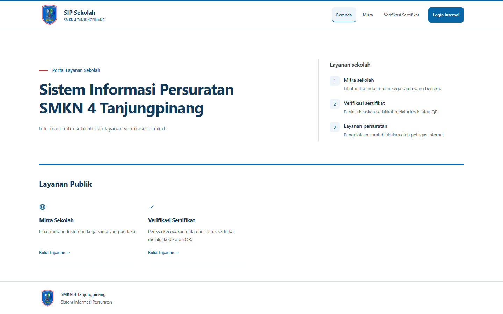
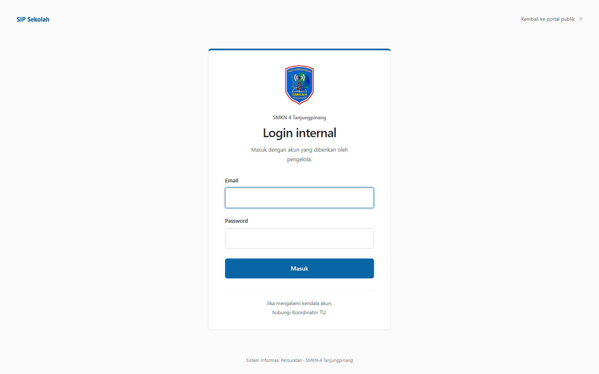

# SIP Sekolah

SIP Sekolah adalah aplikasi internal SMKN 4 Tanjungpinang untuk mencatat dan menindaklanjuti surat sekolah. Aplikasi ini juga menyimpan data mitra dan kerja sama industri, mengelola kegiatan PKL, serta menerbitkan dan memeriksa sertifikat.

Ada dua bagian yang bisa dibuka melalui browser:

- **Portal publik** untuk melihat mitra yang sudah disetujui dan memeriksa sertifikat.
- **Halaman internal** untuk petugas sekolah. Menu dan tindakan yang tersedia mengikuti peran akun setelah login.

## Tampilan terbaru

### Portal publik



### Login internal



## Menjalankan aplikasi setelah clone

### Yang perlu disiapkan

- PHP 8.2 atau lebih baru, termasuk ekstensi `pdo_sqlite` dan `fileinfo`.
- Composer.
- Node.js 20.19+ atau 22.12+, beserta npm.

Di PowerShell, masuk ke folder proyek, lalu jalankan:

```powershell
composer install

if (-not (Test-Path .env)) {
    Copy-Item .env.example .env
}

if (-not (Test-Path database/database.sqlite)) {
    New-Item -ItemType File -Path database/database.sqlite | Out-Null
}

php artisan key:generate
php artisan migrate
npm install
npm run build
```

Salinan `.env.example` sudah menggunakan SQLite dan mode `local`. File `.env` dan database SQLite tidak dibagikan oleh Git; database baru dimulai dalam keadaan kosong. Jangan menimpa `.env` yang sudah dipakai saat menyiapkan proyek.

### Membuat semua akun untuk penggunaan lokal

Setelah migrasi selesai, buat akun internal dengan perintah berikut:

```powershell
php artisan sip:buat-semua-akun
```

Perintah ini hanya berjalan jika `APP_ENV=local`. Pada instalasi baru, sepuluh akun pada tabel di bawah akan dibuat aktif. Setiap akun mendapat password acak yang ditampilkan di terminal saat akun dibuat. Simpan hasilnya saat itu juga; password tidak dapat dilihat kembali dari database.

| Nama akun | Email login | Peran |
|---|---|---|
| Koordinator TU | `tu@smkn4.com` | Koordinator TU |
| Kepala TU | `kepala_tu@smkn4.com` | Kepala TU |
| Kepala Sekolah | `kepala_sekolah@smkn4.com` | Kepala Sekolah |
| Waka Kurikulum | `waka_kurikulum@smkn4.com` | Penerima disposisi |
| Waka Kesiswaan | `waka_kesiswaan@smkn4.com` | Penerima disposisi |
| Waka Sapras | `waka_sapras@smkn4.com` | Penerima disposisi |
| Waka Humas | `waka_humas@smkn4.com` | Waka Humas |
| Pembina OSIS | `pembina_osis@smkn4.com` | Penerima disposisi |
| Bendahara BOS | `bendahara_bos@smkn4.com` | Penerima disposisi |
| Bendahara SPP | `bendahara_spp@smkn4.com` | Penerima disposisi |

Tidak ada satu password bawaan yang berlaku untuk semua instalasi. Untuk menyamakan password seluruh akun internal pada database lokal, jalankan:

```powershell
php artisan sip:reset-password
```

Masukkan password pilihan Anda dua kali. Panjangnya harus 12–72 karakter. Perintah ini menampilkan karakter yang diketik di terminal dan mengganti password semua akun internal di database tersebut, jadi gunakan hanya untuk pengujian lokal dan jangan pakai ulang password penting.

> Seeder standar `php artisan db:seed` adalah pilihan lain: ia membuat lima akun inti (`tu`, `kepala_tu`, `kepala_sekolah`, `penerima_disposisi`, dan `waka_humas`) dan meminta satu password bersama secara interaktif. Seeder menambahkan akun penerima umum `penerima_disposisi@smkn4.com`, tetapi tidak membuat akun penerima lain pada tabel. Jika menjalankan seeder setelah perintah pembuatan akun, password empat akun yang alamatnya beririsan akan ikut diganti.

### Membuka aplikasi

```powershell
php artisan serve
```

Buka `http://127.0.0.1:8000`. Portal publik tersedia di halaman awal; halaman login internal ada di `/login`.

Untuk mengubah tampilan sambil mengembangkan aplikasi, biarkan server Laravel tetap berjalan dan jalankan Vite di terminal kedua:

```powershell
npm run dev
```

## Cara kerja aplikasi

### 1. Surat masuk dan disposisi

1. Koordinator TU mencatat asal, nomor dan tanggal surat, perihal, serta mengunggah berkas PDF. Sistem memberi nomor registrasi dan nomor agenda tahunan.
2. Koordinator TU mengajukan surat kepada Kepala Sekolah untuk ditinjau. Pengajuan yang ditolak dapat diperbaiki dan diajukan kembali.
3. Setelah menyetujui pengajuan, Kepala Sekolah memilih satu atau beberapa penerima aktif, menulis instruksi, menentukan prioritas dan batas waktu, lalu menerbitkan lembar disposisi.
4. Penerima disposisi dan Waka Humas melihat tugas yang ditujukan kepada akunnya. Penerima memulai tindak lanjut, menambahkan catatan atau lampiran bila perlu, lalu menandainya selesai.
5. Riwayat tindak lanjut tersimpan. Surat masuk ditandai selesai setelah semua disposisi untuk surat tersebut selesai.

### 2. Surat keluar

1. Koordinator TU memilih jenis surat lalu mengisi form. Sistem menyusun PDF draf berdasarkan data yang dimasukkan.
2. Kepala TU memeriksa draf. Surat dapat diminta revisi dengan catatan atau diteruskan untuk persetujuan Kepala Sekolah.
3. Jika diminta revisi, Koordinator TU memperbarui surat dan mengajukannya kembali. Jika diteruskan, Koordinator TU mengirimkannya ke antrean Kepala Sekolah.
4. Kepala Sekolah menyetujui surat yang sudah diteruskan. Sesudah disetujui, Koordinator TU menetapkan nomor surat dan mencatat cara serta keterangan pengiriman.
5. Status, catatan, perubahan, dan versi berkas tersimpan di riwayat surat.

### 3. Mitra dan kerja sama industri

Koordinator TU mengelola data mitra, mengajukan kerja sama beserta dokumen pendukung, dan mencatat agenda. Waka Humas memeriksa pengajuan mitra maupun kerja sama, lalu menyetujui atau menolaknya. Informasi mitra dan kerja sama yang disetujui dapat ditampilkan di portal publik.

### 4. Kegiatan PKL dan sertifikat

Koordinator TU membuat periode kegiatan PKL, lalu mengimpor data siswa dari berkas Excel `.xlsx`. Periksa pratinjau dan pilih kelas yang akan dimasukkan sebelum menyimpan. Contoh format impor tersedia di `public/reference/serifikat/Template_Import_Siswa_300.xlsx`.

Setelah PKL berakhir, status siswa dapat ditandai selesai. Koordinator TU kemudian dapat menerbitkan sertifikat per siswa atau sekaligus untuk kelompok kelas/jurusan, mengunduh PDF atau ZIP, dan mencabut sertifikat jika diperlukan. Sertifikat yang aktif bisa diperiksa publik menggunakan kode cetak atau QR.

### 5. Laporan dan akun

Koordinator TU dapat menyaring laporan surat menurut jenis dan rentang tanggal, mengunduh CSV, serta membuka fungsi cetak PDF. Kepala Sekolah memiliki akses laporan sesuai perannya. Koordinator TU juga mengelola akun internal; semua pengguna dapat mengganti password sendiri setelah login.

## Peran akun

| Peran | Pekerjaan utama |
|---|---|
| Koordinator TU | Mencatat surat masuk, membuat dan mengirim surat keluar, mengelola disposisi, mitra, PKL, sertifikat, laporan, dan akun. |
| Kepala TU | Memeriksa surat keluar dan meneruskan atau meminta revisi. |
| Kepala Sekolah | Meninjau pengajuan disposisi, menerbitkan disposisi kepada penerima, serta menyetujui surat keluar. |
| Penerima disposisi | Menangani disposisi yang ditugaskan kepadanya dan mencatat tindak lanjutnya. |
| Waka Humas | Menyetujui pengajuan mitra dan kerja sama, mencatat agenda, serta menangani disposisi yang dikirim kepadanya. |

## Setelah `git pull`

Jika proyek sudah pernah disiapkan di komputer itu, pertahankan `.env`, database lokal, dan berkas unggahan. Ambil perubahan kode dan jalankan:

```powershell
git pull
composer install
npm install
php artisan migrate
npm run build
```

Lalu mulai server dengan `php artisan serve`. Tidak perlu membuat ulang `APP_KEY` atau akun jika keduanya sudah ada. Perintah migrasi menambahkan perubahan struktur database tanpa menghapus data yang sudah tersimpan.

Jika ini komputer baru, ikuti langkah **Menjalankan aplikasi setelah clone** dan **Membuat semua akun untuk penggunaan lokal** di atas. Akun yang dibuat memakai password baru yang tercetak saat proses pembuatan; akun dan password dari komputer lain tidak ikut terbawa oleh `git pull`.

## Data dan berkas

Database SQLite lokal di `database/database.sqlite` serta unggahan privat di `storage/app/private` tidak disimpan di Git. Karena itu, `git pull` hanya memperbarui kode. Agar data dari komputer lama tersedia di komputer baru, pindahkan database dan folder berkas tersebut melalui backup yang aman. Jangan menjalankan `php artisan migrate:fresh` pada database yang berisi data karena perintah itu menghapus semua tabel dan isinya.

PDF surat, dokumen kerja sama, lampiran tindak lanjut, serta berkas sertifikat disimpan di penyimpanan lokal aplikasi. Sertifikat dapat diverifikasi publik tanpa membuka akses langsung ke folder unggahan.

## Jika ada kendala

- **SQLite tidak ditemukan:** pastikan `database/database.sqlite` sudah dibuat, lalu jalankan `php artisan migrate`.
- **Login ditolak:** periksa email, password, dan status akun. Pada lingkungan lokal, `php artisan sip:reset-password` dapat menetapkan password baru bagi semua akun internal.
- **Tampilan gagal dimuat setelah pull:** jalankan kembali `npm install` dan `npm run build`.
- **Impor Excel atau unggahan gagal:** pastikan PHP mengizinkan ukuran unggah yang cukup. Batas PDF surat masuk adalah 5 MB dan berkas Excel 10 MB.

## Teknologi

Laravel 12, PHP 8.2+, SQLite, Blade, Tailwind CSS, Vite, Dompdf, serta FPDF/FPDI untuk kebutuhan PDF.
